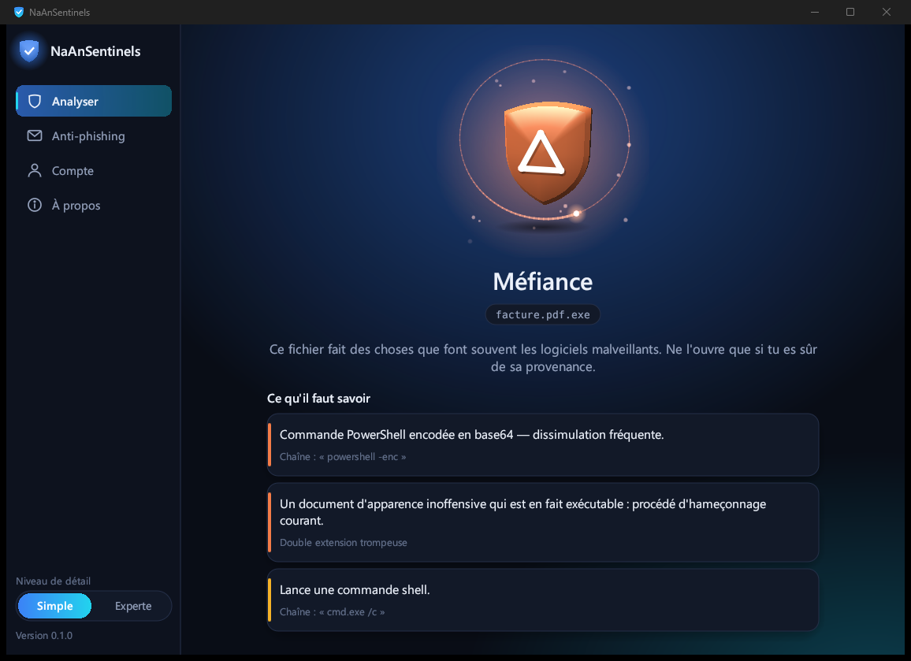
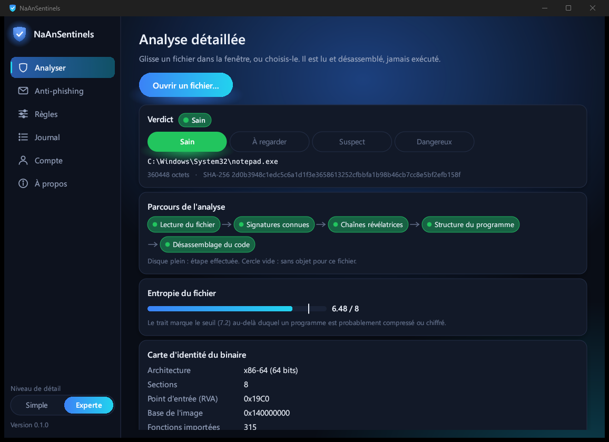
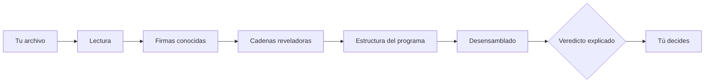

# NaAnSentinels

**Idiomas:** [English](README.md) · [Français](README.fr.md) · Español

**El antivirus de código abierto que te explica lo que ve, en lugar de prohibirte cosas sin motivo.**

La interfaz de la aplicación está por ahora en francés.

¿Tienes dudas sobre un archivo? Arrástralo a NaAnSentinels *antes* de abrirlo. Lo lee, lo desensambla,
te dice lo que encuentra y por qué importa; después te deja decidir. No bloquea nada, no elimina nada,
y la ausencia de firma nunca es un veredicto por sí sola.

| Vista simple | Veredicto explicado | Vista experta |
|---|---|---|
|  |  |  |

## Qué hace

- **Análisis estático antes de la ejecución** de un programa de Windows (`.exe`, `.dll`, instalador). El archivo nunca se ejecuta.
- **Ingeniería inversa**: desensamblado x86/x64 del punto de entrada, mapa de secciones, funciones importadas.
- **Veredicto explicado**: cada hallazgo dice lo que se observa *y* por qué importa, incluido «a menudo es legítimo».
- **Antiphishing sin conexión**: pega un correo o abre un `.eml`; enlaces engañosos, dominios en forma de IP o en punycode, tono de urgencia.
- **Reglas abiertas y editables** (`rules/signatures.toml`), recargables desde la aplicación.
- **Dos niveles de lectura**: una vista simple animada para todo el mundo, una vista experta con esquemas.



## Las dos vistas

- **Vista simple** (« Vue simple », por defecto): un escudo animado, una frase en lenguaje corriente, tres puntos
  como máximo. Para responder a una sola pregunta: «¿puedo abrirlo o no?».
- **Vista experta** (« Vue experte »): escala del veredicto, recorrido del análisis, medidor de entropía, mapa de
  secciones, desensamblado, editor de reglas, registro.

Se pasa de una a otra con un clic, en la parte superior de la ventana.

## Instalar y ejecutar

Necesitas [Rust](https://www.rust-lang.org/tools/install) (en Windows: `winget install Rustlang.Rustup`, más las
herramientas de compilación de C++ de Visual Studio).

```powershell
git clone https://github.com/NoamL55/NaAnSentinels.git
cd NaAnSentinels
cargo run --release
```

| Comando | Efecto |
|---|---|
| `naansentinels` | abre la interfaz |
| `naansentinels <fichier>` | abre la interfaz con el análisis de ese archivo (práctico para «Abrir con…») |
| `naansentinels --analyser <fichier>` | informe de texto en la terminal |
| `naansentinels --verifier <fichier>` | indica si un ejecutable es una versión oficial |

Mantén `config.toml` y la carpeta `rules/` junto al ejecutable, o ejecútalo desde la carpeta del proyecto.

## Modificar

Todo está hecho para que puedas retomarlo:

- **Reglas**: `rules/signatures.toml` — firmas, funciones importadas sospechosas, cadenas reveladoras, con su gravedad y su explicación.
- **Umbrales y tema**: `config.toml`.
- **Código**: el motor (`src/engine/`) no depende de la interfaz (`src/ui/`). Consulta [docs/es/arquitectura.md](docs/es/arquitectura.md).

```powershell
cargo test --workspace
```

## Señal de presencia y cuenta: opcionales

NaAnSentinels funciona por completo **sin servidor y sin cuenta**. Si indicas un servidor y activas
la señal (desactivada por defecto), esto es lo que se envía cada minuto; la pestaña *Cuenta* (« Compte ») lo
muestra tal cual:

| Se envía | Nunca se envía |
|---|---|
| un identificador aleatorio de instalación | tus archivos, sus nombres, sus rutas |
| la versión y el sistema | las huellas de tus archivos |
| el número de análisis, por veredicto | tus correos y tus enlaces |
| tu alias, solo si inicias sesión | tu dirección IP no se registra |

## El servidor y su panel de control

La carpeta `server/` contiene un pequeño servidor autoalojable: cuentas, roles, panel de control.

```powershell
cargo run -p naansentinels-server -- creer-admin <pseudo>   # se pide la contraseña, nunca se muestra
cargo run -p naansentinels-server                           # http://127.0.0.1:8791
```

| Rol | Sus dispositivos | Panel de control | Cuentas y registro |
|---|:---:|:---:|:---:|
| usuario (`utilisateur`) | sí | no | no |
| analista (`analyste`) | sí | lectura | no |
| admin (`admin`) | sí | lectura | sí |

El panel de control también tiene una vista simple y una vista detallada. Modelo de seguridad, qué se almacena y
límites conocidos: [docs/es/seguridad.md](docs/es/seguridad.md).

## ¿Versión oficial o versión derivada?

El código es libre: puedes copiarlo, modificarlo y redistribuirlo (licencia MIT). Para que cualquiera pueda
distinguir **la versión original** de una copia, los ejecutables oficiales están firmados (Ed25519):

```powershell
naansentinels --verifier naansentinels.exe
```

Huella de la clave oficial: **`a95e daa9 0120 33aa`** (también se muestra en *Acerca de*, « À propos »).

Una copia modificada no puede producir esa firma. Solo puede estar firmada con otra clave, cuya
huella será distinta. Detalles y procedimiento para firmar tus propias versiones: [docs/es/firma.md](docs/es/firma.md).

## Límites — dichos con franqueza

- NaAnSentinels no conoce **más que sus reglas**: «Sano» (« Sain ») quiere decir «nada conocido», no «seguro garantizado».
- No sustituye al antivirus de tu sistema y no vigila en **tiempo real**: el análisis es bajo demanda.
- Solo una **firma exacta** da «Peligroso» (« Dangereux »); las heurísticas dan como mucho «Sospechoso» (« Suspect »).
- El antiphishing analiza un correo que tú le das; no se conecta a tu buzón.
- La firma Authenticode de los archivos analizados todavía no se verifica.

Próximos pasos previstos: [docs/es/hoja-de-ruta.md](docs/es/hoja-de-ruta.md).

## Licencia y crédito

Licencia [MIT](LICENSE) — Copyright (c) 2026 Noam Lellouche.

Puedes reutilizar este código, incluso en un proyecto tuyo. La licencia solo pide una cosa: conservar el aviso
de copyright y el texto de la licencia en toda copia o parte sustancial. Consulta también [NOTICE](NOTICE).
