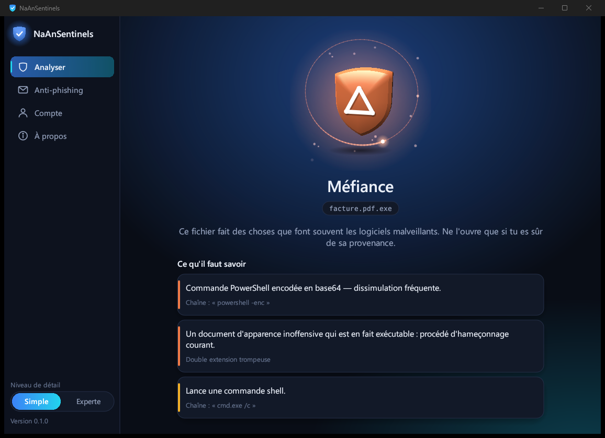
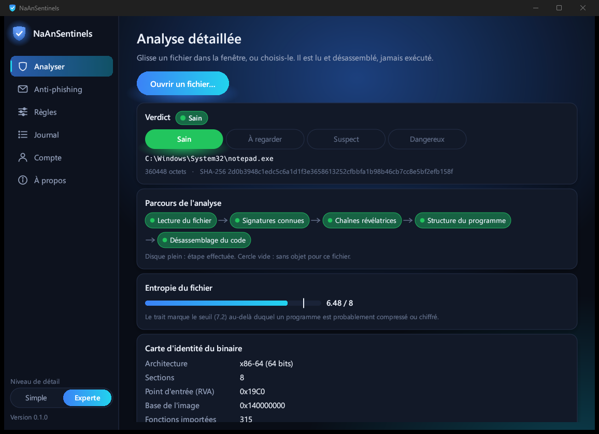
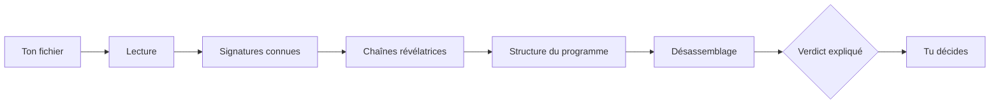

# NaAnSentinels

**Langues :** [English](README.md) · Français · [Español](README.es.md)

**L'antivirus open source qui t'explique ce qu'il voit, au lieu de t'interdire sans raison.**

Tu as un doute sur un fichier ? Glisse-le dans NaAnSentinels *avant* de l'ouvrir. Il le lit, le désassemble,
te dit ce qu'il y trouve et pourquoi ça compte — puis il te laisse décider. Il ne bloque rien, ne supprime rien,
et l'absence de signature n'est jamais un verdict à elle seule.

| Vue simple | Verdict expliqué | Vue experte |
|---|---|---|
|  |  |  |

## Ce qu'il fait

- **Analyse statique avant exécution** d'un programme Windows (`.exe`, `.dll`, installeur). Le fichier n'est jamais lancé.
- **Reverse engineering** : désassemblage x86/x64 du point d'entrée, carte des sections, fonctions importées.
- **Verdict expliqué** : chaque constat dit ce qui est observé *et* pourquoi ça compte, y compris « c'est souvent légitime ».
- **Anti-phishing hors-ligne** : colle un mail ou ouvre un `.eml` ; liens trompeurs, domaines en IP ou en punycode, ton d'urgence.
- **Règles ouvertes et éditables** (`rules/signatures.toml`), rechargeables depuis l'application.
- **Deux niveaux de lecture** : une vue simple animée pour tout le monde, une vue experte avec schémas.



## Les deux vues

- **Vue simple** (par défaut) : un bouclier en 3D, une phrase en langage courant, trois points au plus.
  Pour répondre à une seule question : « je peux l'ouvrir ou pas ? ».
- **Vue experte** : échelle du verdict, parcours de l'analyse, jauge d'entropie, carte des sections,
  désassemblage, éditeur de règles, journal.

On passe de l'une à l'autre en un clic, en bas de la barre latérale.

## Installer et lancer

Il faut [Rust](https://www.rust-lang.org/tools/install) (sous Windows : `winget install Rustlang.Rustup`, plus les
outils de compilation C++ de Visual Studio).

```powershell
git clone https://github.com/NoamL55/NaAnSentinels.git
cd NaAnSentinels
cargo run --release
```

| Commande | Effet |
|---|---|
| `naansentinels` | ouvre l'interface |
| `naansentinels <fichier>` | ouvre l'interface sur l'analyse de ce fichier (pratique pour « Ouvrir avec… ») |
| `naansentinels --analyser <fichier>` | rapport texte dans le terminal |
| `naansentinels --verifier <fichier>` | dit si un exécutable est une version officielle |

Garde `config.toml` et le dossier `rules/` à côté de l'exécutable, ou lance-le depuis le dossier du projet.

## Modifier

Tout est fait pour être repris :

- **Règles** : `rules/signatures.toml` — signatures, fonctions importées suspectes, chaînes révélatrices, avec leur gravité et leur explication.
- **Seuils et thème** : `config.toml`.
- **Code** : le moteur (`src/engine/`) ne dépend pas de l'interface (`src/ui/`). Voir [docs/fr/architecture.md](docs/fr/architecture.md).

```powershell
cargo test --workspace
```

## Signal de présence et compte : facultatifs

NaAnSentinels fonctionne entièrement **sans serveur et sans compte**. Si tu indiques un serveur et que tu actives
le signal (désactivé par défaut), voici ce qui part toutes les minutes — l'onglet *Compte* l'affiche tel quel :

| Envoyé | Jamais envoyé |
|---|---|
| un identifiant aléatoire d'installation | tes fichiers, leurs noms, leurs chemins |
| la version et le système | les empreintes de tes fichiers |
| le nombre d'analyses, par verdict | tes mails et tes liens |
| ton pseudo, seulement si tu te connectes | ton adresse IP n'est pas enregistrée |

## Le serveur et son tableau de bord

Le dossier `server/` contient un petit serveur auto-hébergeable : comptes, rôles, tableau de bord.

```powershell
cargo run -p naansentinels-server -- creer-admin <pseudo>   # mot de passe demandé, jamais affiché
cargo run -p naansentinels-server                           # http://127.0.0.1:8791
```

| Rôle | Ses appareils | Tableau de bord | Comptes et journal |
|---|:---:|:---:|:---:|
| utilisateur | oui | non | non |
| analyste | oui | lecture | non |
| admin | oui | lecture | oui |

Le tableau de bord a lui aussi une vue simple et une vue détaillée. Modèle de sécurité, ce qui est stocké et
limites connues : [docs/fr/securite.md](docs/fr/securite.md).

## Version officielle ou version dérivée ?

Le code est libre : tu peux le copier, le modifier, le redistribuer (licence MIT). Pour que chacun puisse
distinguer **la version d'origine** d'une copie, les exécutables officiels sont signés (Ed25519) :

```powershell
naansentinels --verifier naansentinels.exe
```

Empreinte de la clé officielle : **`a95e daa9 0120 33aa`** (elle s'affiche aussi dans *À propos*).

Une copie modifiée ne peut pas produire cette signature. Elle peut seulement être signée par une autre clé, dont
l'empreinte sera différente. Détails et procédure pour signer tes propres versions : [docs/fr/signature.md](docs/fr/signature.md).

## Limites — dites franchement

- NaAnSentinels ne connaît **que ses règles** : « Sain » veut dire « rien de connu », pas « garanti sûr ».
- Il ne remplace pas l'antivirus de ton système et ne surveille pas en **temps réel** : l'analyse est à la demande.
- Seule une **signature exacte** donne « Dangereux » ; les heuristiques donnent au mieux « Suspect ».
- L'anti-phishing analyse un mail que tu lui donnes ; il ne se connecte pas à ta boîte.
- La signature Authenticode des fichiers analysés n'est pas encore vérifiée.

Suite prévue : [docs/fr/feuille-de-route.md](docs/fr/feuille-de-route.md).

## Licence et crédit

Licence [MIT](LICENSE) — Copyright (c) 2026 Noam Lellouche.

Tu peux réutiliser ce code, y compris dans un projet à toi. La licence demande une seule chose : conserver la mention
de copyright et le texte de la licence dans toute copie ou partie substantielle. Voir aussi [NOTICE](NOTICE).
