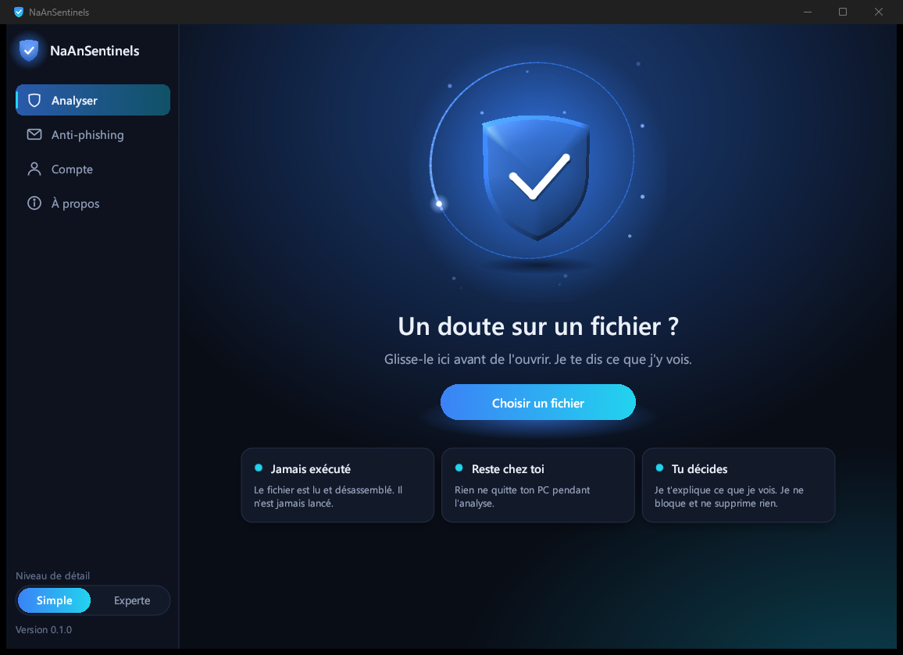
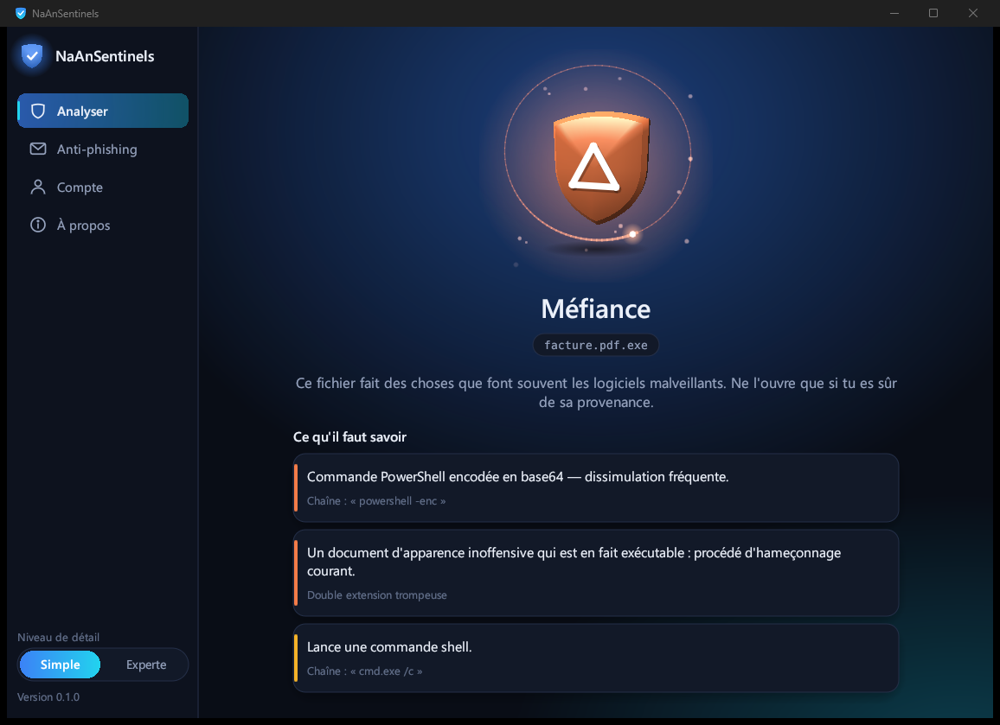
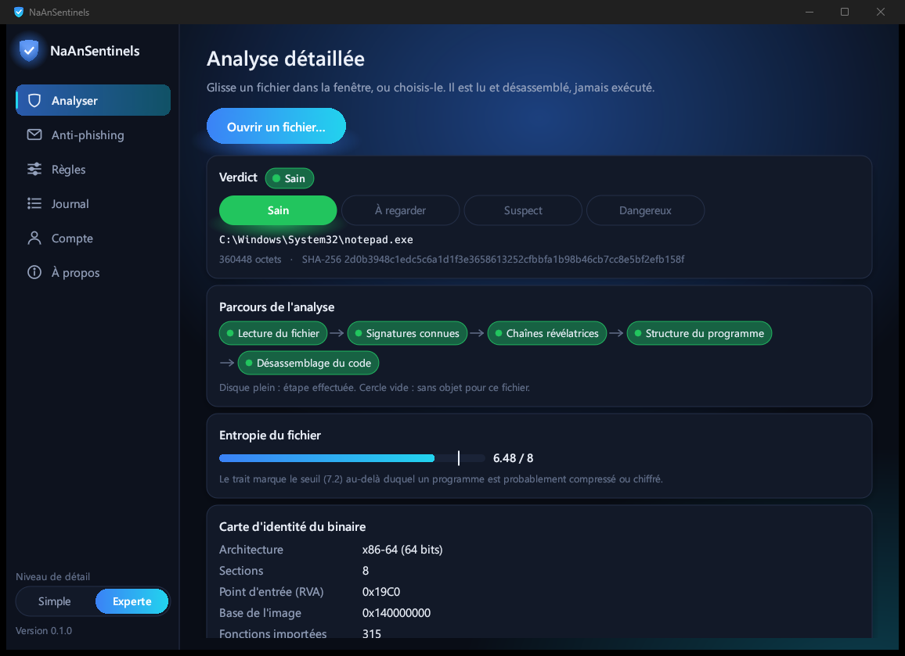
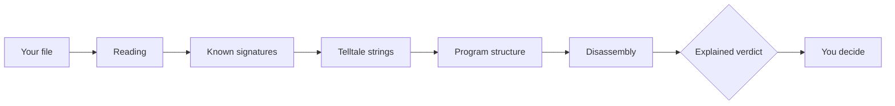

# NaAnSentinels

**Languages:** English · [Français](README.fr.md) · [Español](README.es.md)

**The open-source antivirus that explains what it sees, instead of forbidding things for no reason.**

Not sure about a file? Drop it into NaAnSentinels *before* you open it. It reads it, disassembles it,
tells you what it finds in it and why that matters — then it lets you decide. It blocks nothing, deletes nothing,
and a missing signature is never a verdict on its own.

The application's interface is currently in French.

| Simple view | Explained verdict | Expert view |
|---|---|---|
|  |  |  |

## What it does

- **Static analysis before execution** of a Windows program (`.exe`, `.dll`, installer). The file is never run.
- **Reverse engineering**: x86/x64 disassembly of the entry point, section map, imported functions.
- **Explained verdict**: each finding says what is observed *and* why it matters, including "this is often legitimate".
- **Offline anti-phishing**: paste an email or open a `.eml`; misleading links, IP or punycode domains, urgent tone.
- **Open, editable rules** (`rules/signatures.toml`), reloadable from within the application.
- **Two reading levels**: an animated simple view for everyone, an expert view with diagrams.



## The two views

- **Simple view** (« Vue simple », the default): an animated shield, one sentence in plain language, three points
  at most. It answers a single question: "can I open it or not?".
- **Expert view** (« Vue experte »): verdict scale, analysis path, entropy gauge, section map,
  disassembly, rule editor, log.

You switch from one to the other in one click, at the top of the window.

## Install and run

You need [Rust](https://www.rust-lang.org/tools/install) (on Windows: `winget install Rustlang.Rustup`, plus the
Visual Studio C++ build tools).

```powershell
git clone https://github.com/NoamL55/NaAnSentinels.git
cd NaAnSentinels
cargo run --release
```

| Command | Effect |
|---|---|
| `naansentinels` | opens the interface |
| `naansentinels <file>` | opens the interface on the analysis of that file (handy for "Open with…") |
| `naansentinels --analyser <file>` | text report in the terminal |
| `naansentinels --verifier <file>` | tells whether an executable is an official release |

Keep `config.toml` and the `rules/` folder next to the executable, or run it from the project folder.

## Modify

Everything is made to be picked up and changed:

- **Rules**: `rules/signatures.toml` — signatures, suspicious imported functions, telltale strings, with their severity and their explanation.
- **Thresholds and theme**: `config.toml`.
- **Code**: the engine (`src/engine/`) does not depend on the interface (`src/ui/`). See [docs/en/architecture.md](docs/en/architecture.md).

```powershell
cargo test --workspace
```

## Presence signal and account: optional

NaAnSentinels works entirely **without a server and without an account**. If you specify a server and turn on
the signal (off by default), here is what is sent every minute — the Account tab (« Compte ») shows it as is:

| Sent | Never sent |
|---|---|
| a random installation identifier | your files, their names, their paths |
| the version and the operating system | the hashes of your files |
| the number of analyses, per verdict | your emails and your links |
| your username, only if you sign in | your IP address is not recorded |

## The server and its dashboard

The `server/` folder contains a small self-hostable server: accounts, roles, dashboard.

```powershell
cargo run -p naansentinels-server -- creer-admin <username>   # password is prompted for, never displayed
cargo run -p naansentinels-server                             # http://127.0.0.1:8791
```

| Role | Their own devices | Dashboard | Accounts and log |
|---|:---:|:---:|:---:|
| user (`utilisateur`) | yes | no | no |
| analyst (`analyste`) | yes | read-only | no |
| admin (`admin`) | yes | read-only | yes |

The dashboard also has a simple view and a detailed view. Security model, what is stored and
known limits: [docs/en/security.md](docs/en/security.md).

## Official release or derived version?

The code is free: you can copy it, modify it, redistribute it (MIT license). So that everyone can
tell **the original version** from a copy, the official executables are signed (Ed25519):

```powershell
naansentinels --verifier naansentinels.exe
```

Fingerprint of the official key: **`a95e daa9 0120 33aa`** (it is also shown in the About tab, « À propos »).

A modified copy cannot produce this signature. It can only be signed with another key, whose
fingerprint will be different. Details and the procedure for signing your own versions: [docs/en/signature.md](docs/en/signature.md).

## Limits — stated frankly

- NaAnSentinels knows **only its rules**: Safe (« Sain ») means "nothing known", not "guaranteed safe".
- It does not replace your system's antivirus and does not monitor in **real time**: analysis is on demand.
- Only an **exact signature** gives Dangerous (« Dangereux »); heuristics give Suspicious (« Suspect ») at most.
- The anti-phishing analyzes an email you give it; it does not connect to your mailbox.
- The Authenticode signature of analyzed files is not verified yet.

What is planned next: [docs/en/roadmap.md](docs/en/roadmap.md).

## License and credit

[MIT](LICENSE) license — Copyright (c) 2026 Noam Lellouche.

You can reuse this code, including in a project of your own. The license asks for one thing only: keep the copyright
notice and the license text in any copy or substantial portion. See also [NOTICE](NOTICE).
