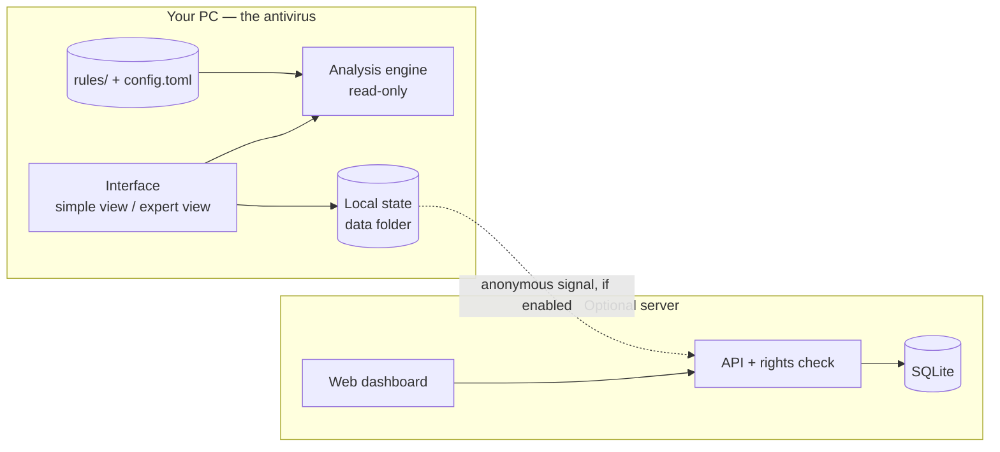
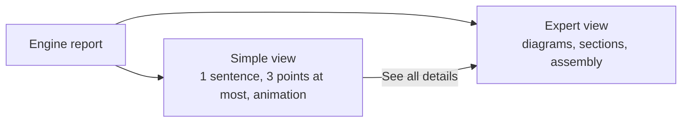

# NaAnSentinels architecture

**Languages:** English · [Français](../fr/architecture.md) · [Español](../es/arquitectura.md)

Two programs in a single Cargo workspace: the **antivirus** (at the root) and an optional **server**
(`server/`). The antivirus works entirely without the server.



## The antivirus

```
src/
  main.rs            entry point and terminal commands
  engine/            THE ENGINE — no interface, no destructive action
    config.rs        config.toml (thresholds, theme); default values if missing
    rules.rs         rules/signatures.toml (signatures, suspicious imports, strings)
    verdict.rs       Niveau, Constat, Rapport (level, finding, report): the explained verdict
    heuristics.rs    entropy, ASCII strings, double extension, hex, SHA-256
    pe.rs            static analysis of the PE format: sections, imports, entry point
    disasm.rs        x86/x64 disassembly
    scan.rs          orchestration: one file -> one Rapport
  phishing.rs        offline analysis of an email (links, punycode, urgency…)
  etat.rs            local state: random identifier, signal choice, counters
  signal.rs          optional presence signal and account (HTTPS)
  signature.rs       signing of official releases (Ed25519)
  ui/
    mod.rs           window, sidebar, anti-phishing, rules, log, about
    theme.rs         look and feel: palette, fonts, cards, buttons, gradients
    bouclier3d.rs    the 3D shield: a lit, animated model
    simple.rs        simple view: 3D shield, one-sentence verdict
    expert.rs        expert view: diagrams, section map, disassembly
    compte.rs        Account tab: signal and sign-in
config.toml          thresholds and theme
rules/signatures.toml  detection rules
keys/officielle.pub  public key of the official releases
```

### Principles

1. **The analyzed file is never executed.** Everything is static: reading, structure analysis, disassembly.
2. **Read-only.** The engine does not block, move or delete anything. It produces a report.
3. **Explain, don't give orders.** Each finding has an *observation* (the fact) and a *why* (the honest context).
4. **Modifiable.** The rules and the config are text files; the engine is separate from the interface.
5. **Nothing leaves without consent.** The signal is off by default and its content is shown as is.

### The verdict

Safe (`Sain`) < Worth a look (`À regarder`) < Suspicious (`Suspect`) < Dangerous (`Dangereux`). A file's level
is that of its worst finding.

- **Dangerous**: only an **exact signature** (string, bytes or SHA-256 from a rule).
- **Suspicious / Worth a look**: heuristics (section that is both executable and writable, high entropy,
  dangerous imported function, double extension). Never proof on their own.
- **Safe**: nothing known. This is **not** a guarantee.

### The two views



The simple view makes nothing up: its animation replays the steps the engine actually carried out, and its sentences
come from the same findings as the expert view.

On screen, the labels are in French: « Vue simple », « Vue experte », and « Voir tous les détails » for
"See all details".

## The server

```
server/
  src/
    main.rs          startup, settings, creer-admin command
    auth.rs          Argon2id, tokens, roles and rights
    db.rs            SQLite: accounts, sessions, devices, log
    limite.rs        in-memory rate limiter
    routes.rs        HTTP routes, rights check, security headers
  web/               dashboard (HTML, CSS, JS embedded in the executable)
```

Detailed security model: [security.md](security.md).

## Main dependencies

| Library | Role |
|---|---|
| `eframe` / `egui` | graphical interface |
| `goblin` | reading the PE format |
| `iced-x86` | x86/x64 disassembler |
| `sha2` | SHA-256 hashes |
| `serde`, `toml`, `serde_json` | rules, config, state |
| `rfd` | "open a file" dialogs |
| `ureq` | HTTPS client for the signal |
| `ed25519-dalek` | signing of official releases |
| `axum`, `tokio` | web server |
| `rusqlite` | SQLite database |
| `argon2` | password hashes |
