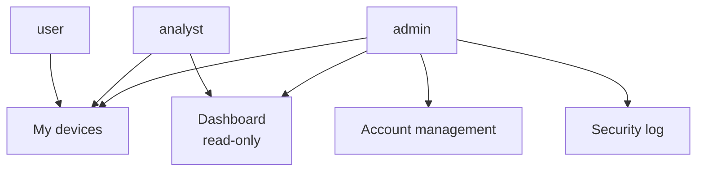

# Server security and privacy

**Languages:** English · [Français](../fr/securite.md) · [Español](../es/seguridad.md)

The server (`server/`) is optional. It does three things: keep accounts, receive the presence signal
from the installations that have turned it on, and display a dashboard reserved for the roles entitled to it.

## Who sees what

| Right | user (`utilisateur`) | analyst (`analyste`) | admin (`admin`) |
|---|:---:|:---:|:---:|
| `appareils:les-miens` | yes | yes | yes |
| `tableau:lire` | no | yes | yes |
| `utilisateurs:gerer` | no | no | yes |
| `journal:lire` | no | no | yes |

Each protected route checks the session **and then** the right: 401 without a session, 403 without the right. The
rights are defined in a single place, `server/src/auth.rs`.

Safeguards on account management: an admin can neither change their own role nor disable their own account,
and there is always at least one active administrator left. Disabling an account closes all of its sessions.

## What is stored

| Data | Form |
|---|---|
| Password | Argon2id hash with a random salt — never the password |
| Session | SHA-256 hash of the token — never the token; expires after 7 days |
| Device | random identifier, version, operating system, counters, date of the last signal |
| Log | successful and refused sign-ins, account creations, role changes |

**Never** stored: IP addresses, file names or paths, file hashes, email content.
A signal containing an unknown field is rejected (`deny_unknown_fields`).

In the dashboard, a device's identifier is truncated to 8 characters.

## Defenses in place

- **Passwords**: at least 10 characters, Argon2id. Verification takes the same time whether the username exists or
  not, so as not to reveal which accounts exist.
- **Anti-stuffing rate limit**: 8 sign-in attempts per quarter of an hour for an address + username pair; 5 account
  creations per hour and 30 signals per minute per address.
- **Session cookie**: `HttpOnly`, `SameSite=Strict`, and `Secure` when `NAANSENTINELS_HTTPS=1`.
- **Anti-CSRF**: every write to the API requires the `X-NaAnSentinels` header, which a third-party page cannot send.
- **Headers**: strict content policy (no inline script or style, no external resource),
  `X-Frame-Options: DENY`, `nosniff`, no referrer, no caching on the API.
- **Web page**: any data coming from the server is inserted as text, never as HTML.
- **Requests**: body limited to 16 KB, validated inputs (username, identifier, version, operating system, counters).
- **On the antivirus side**: HTTPS is mandatory towards the server (HTTP is accepted only towards the local
  machine); the password leaves the input field as soon as it is sent and is never written to disk.

## Known limits — stated frankly

- **The signal is self-reported.** Anyone can send fake signals and inflate the counters (within the limits of
  the rate limiter). The dashboard is an indicator, not a certified measurement.
- **The rate limiter is in memory**: it starts again from zero on restart and is not shared between several
  instances.
- **Behind a proxy**, the server sees the proxy's address: the limiter then applies to everyone together.
  To be adapted (trusted header) before a public deployment.
- **No built-in TLS**: in production, put the server behind an HTTPS proxy and set `NAANSENTINELS_HTTPS=1`.
- **The antivirus's session token** is stored in clear text in the user's data folder. It only
  gives access to the NaAnSentinels account, but it is not encrypted.
- **No two-factor authentication**, no password reset by email.
- This server has not undergone an independent audit.

## Deploying

| Variable | Role | Default |
|---|---|---|
| `NAANSENTINELS_ADRESSE` | listening address | `127.0.0.1:8791` |
| `NAANSENTINELS_BASE` | SQLite file | `naansentinels-serveur.db` |
| `NAANSENTINELS_HTTPS` | `1` if the server is behind HTTPS | `0` |
| `NAANSENTINELS_INSCRIPTIONS` | `ouvertes` (sign-ups open) or `fermees` (sign-ups closed) | `ouvertes` |

By default the server listens only on the local machine. Create the first administrator with
`naansentinels-server creer-admin <username>`: the password is prompted for without echo and is never logged.

## Reporting a vulnerability

Open an issue on the repository describing the problem without publishing exploitable details, or submit
a fix directly.
