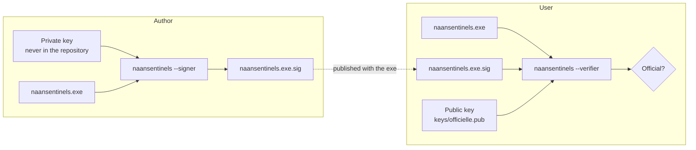

# Signing of official releases

**Languages:** English · [Français](../fr/signature.md) · [Español](../es/firma.md)

## What it is for, and what it is not for

NaAnSentinels is open source: **anyone can copy, modify and redistribute the code**. No technique can
prevent that, and that is not the goal.

The signature answers a different question: **"does this executable really come from the original author?"**

- It **proves the origin**: only the holder of the private key can produce a valid signature for the public
  key `keys/officielle.pub`.
- It **detects any modification**: a single changed byte invalidates the signature.
- It **does not prevent copying**. A derived version can remove the check or replace it with its own key;
  but it will never be able to show the official fingerprint.

Legal protection comes from the **license** (MIT: the copyright notice must be kept) and from the
`NOTICE` file. The signature, for its part, gives users a simple way to check.



## Verifying an executable

```powershell
naansentinels --verifier naansentinels.exe
```

| Answer | Meaning |
|---|---|
| `OFFICIELLE` | official: valid signature for the official key |
| `NON SIGNÉE` | not signed: no `.sig` file — personal build or derived version |
| `INVALIDE` | invalid: file modified, or signed with another key |

Fingerprint of the official key: **`a95e daa9 0120 33aa`**. The About tab (« À propos ») shows the same status for
the running executable.

## Publishing an official release (author)

```powershell
cargo build --release
target\release\naansentinels.exe --signer target\release\naansentinels.exe
```

Publish `naansentinels.exe` and `naansentinels.exe.sig` together.

The private key is in the user's data folder (`%APPDATA%\NaAnSentinels\cle-signature-privee.key`
on Windows). It is never displayed, never overwritten, never put under version control. **Make an offline backup
of it**: if it is lost, a new key will have to be published; if it leaks, anyone will be able to produce
signatures in your name.

## Signing your own derived version

```powershell
naansentinels --generer-cle        # creates YOUR key pair; prints the public key and its fingerprint
```

Replace the content of `keys/officielle.pub` with your public key, rebuild, sign. Your version will then have its own
fingerprint — different from the official one, which is exactly the point.

## Technical details

- Algorithm: Ed25519, **strict** verification (weak keys and malleable signatures are rejected).
- An all-zero public key means "no key published" and never validates anything.
- The signature covers the entire content of the file.
- Known limit: the status shown in About is computed by the executable itself. For an independent
  check, verify with a trusted executable or another Ed25519 tool.
