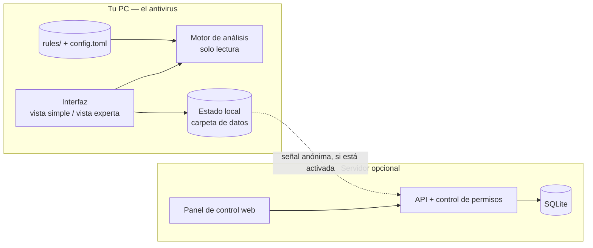
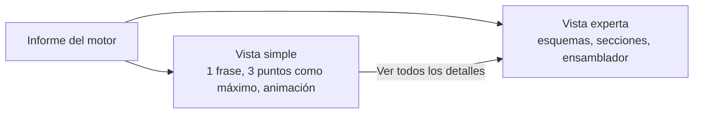

# Arquitectura de NaAnSentinels

**Idiomas:** [English](../en/architecture.md) · [Français](../fr/architecture.md) · Español

Dos programas en un mismo espacio de trabajo de Cargo: el **antivirus** (en la raíz) y un **servidor** opcional
(`server/`). El antivirus funciona por completo sin el servidor.



## El antivirus

```
src/
  main.rs            punto de entrada y comandos de la terminal
  engine/            EL MOTOR — ninguna interfaz, ninguna acción destructiva
    config.rs        config.toml (umbrales, tema); valores por defecto si falta
    rules.rs         rules/signatures.toml (firmas, importaciones sospechosas, cadenas)
    verdict.rs       Niveau, Constat, Rapport: el veredicto explicado
    heuristics.rs    entropía, cadenas ASCII, doble extensión, hex, SHA-256
    pe.rs            análisis estático del formato PE: secciones, importaciones, punto de entrada
    disasm.rs        desensamblado x86/x64
    scan.rs          orquestación: un archivo -> un Rapport
  phishing.rs        análisis sin conexión de un correo (enlaces, punycode, urgencia…)
  etat.rs            estado local: identificador aleatorio, elección de la señal, contadores
  signal.rs          señal de presencia opcional y cuenta (HTTPS)
  signature.rs       firma de las versiones oficiales (Ed25519)
  ui/
    mod.rs           ventana, barra lateral, antiphishing, reglas, registro, acerca de
    theme.rs         apariencia: paleta, fuentes, tarjetas, botones, degradados
    bouclier3d.rs    el escudo en 3D: modelo iluminado y animado
    simple.rs        vista simple: escudo 3D, veredicto en una frase
    expert.rs        vista experta: esquemas, mapa de secciones, desensamblado
    compte.rs        pestaña Cuenta (« Compte »): señal e inicio de sesión
config.toml          umbrales y tema
rules/signatures.toml  reglas de detección
keys/officielle.pub  clave pública de las versiones oficiales
```

### Principios

1. **Nunca se ejecuta el archivo analizado.** Todo es estático: lectura, análisis de estructura, desensamblado.
2. **Solo lectura.** El motor no bloquea, no mueve ni elimina nada. Produce un informe.
3. **Explicar, no ordenar.** Cada hallazgo tiene una *observación* (el hecho) y un *porqué* (el contexto honesto).
4. **Modificable.** Las reglas y la configuración son archivos de texto; el motor está separado de la interfaz.
5. **Nada sale sin consentimiento.** La señal está desactivada por defecto y su contenido se muestra tal cual.

### El veredicto

Sano (`Sain`) < A revisar (`À regarder`) < Sospechoso (`Suspect`) < Peligroso (`Dangereux`). El nivel de un
archivo es el de su peor hallazgo.

- **Peligroso**: únicamente una **firma exacta** (cadena, bytes o SHA-256 de una regla).
- **Sospechoso / A revisar**: heurísticas (sección ejecutable y modificable, entropía alta, función importada
  peligrosa, doble extensión). Nunca son una prueba por sí solas.
- **Sano**: nada conocido. **No** es una garantía.

### Las dos vistas



La vista simple (« Vue simple ») no inventa nada: su animación reproduce las etapas que el motor ha realizado de
verdad, y sus frases salen de los mismos hallazgos que la vista experta (« Vue experte »).

## El servidor

```
server/
  src/
    main.rs          arranque, ajustes, comando creer-admin
    auth.rs          Argon2id, tokens, roles y permisos
    db.rs            SQLite: cuentas, sesiones, dispositivos, registro
    limite.rs        limitador de tasa en memoria
    routes.rs        rutas HTTP, control de permisos, cabeceras de seguridad
  web/               panel de control (HTML, CSS, JS integrados en el ejecutable)
```

Modelo de seguridad detallado: [seguridad.md](seguridad.md).

## Dependencias principales

| Biblioteca | Función |
|---|---|
| `eframe` / `egui` | interfaz gráfica |
| `goblin` | lectura del formato PE |
| `iced-x86` | desensamblador x86/x64 |
| `sha2` | huellas SHA-256 |
| `serde`, `toml`, `serde_json` | reglas, configuración, estado |
| `rfd` | cuadros de diálogo «abrir un archivo» |
| `ureq` | cliente HTTPS de la señal |
| `ed25519-dalek` | firma de las versiones oficiales |
| `axum`, `tokio` | servidor web |
| `rusqlite` | base de datos SQLite |
| `argon2` | huellas de contraseñas |
