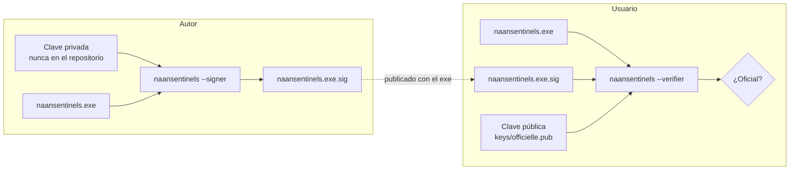

# Firma de las versiones oficiales

**Idiomas:** [English](../en/signature.md) · [Français](../fr/signature.md) · Español

## Para qué sirve y para qué no

NaAnSentinels es de código abierto: **cualquiera puede copiar, modificar y redistribuir el código**. Ninguna técnica
puede impedirlo, y no es ese el objetivo.

La firma responde a otra pregunta: **«¿este ejecutable procede realmente del autor original?»**

- **Demuestra el origen**: solo quien posee la clave privada puede producir una firma válida para la clave
  pública `keys/officielle.pub`.
- **Detecta cualquier modificación**: un solo byte cambiado invalida la firma.
- **No impide la copia**. Una versión derivada puede quitar la verificación o sustituirla por su propia clave;
  pero nunca podrá presentar la huella oficial.

La protección jurídica procede de la **licencia** (MIT: el aviso de copyright debe conservarse) y del archivo
`NOTICE`. La firma, por su parte, da a los usuarios un medio sencillo de comprobarlo.



## Verificar un ejecutable

```powershell
naansentinels --verifier naansentinels.exe
```

| Respuesta | Significado |
|---|---|
| `OFFICIELLE` | firma válida para la clave oficial |
| `NON SIGNÉE` | no hay archivo `.sig`: compilación personal o versión derivada |
| `INVALIDE` | archivo modificado, o firmado con otra clave |

Huella de la clave oficial: **`a95e daa9 0120 33aa`**. La pestaña *Acerca de* (« À propos ») muestra el mismo
estado para el ejecutable en curso.

## Publicar una versión oficial (autor)

```powershell
cargo build --release
target\release\naansentinels.exe --signer target\release\naansentinels.exe
```

Publica juntos `naansentinels.exe` y `naansentinels.exe.sig`.

La clave privada está en la carpeta de datos del usuario (`%APPDATA%\NaAnSentinels\cle-signature-privee.key`
en Windows). Nunca se muestra, nunca se sobrescribe, nunca se versiona. **Haz una copia de seguridad sin
conexión**: si se pierde, habrá que publicar una nueva clave; si se filtra, cualquiera podrá firmar en tu lugar.

## Firmar tu propia versión derivada

```powershell
naansentinels --generer-cle        # crea TU par de claves; muestra la clave pública y su huella
```

Sustituye el contenido de `keys/officielle.pub` por tu clave pública, recompila, firma. Tu versión tendrá
entonces su propia huella — distinta de la oficial, que es exactamente el objetivo.

## Detalles técnicos

- Algoritmo: Ed25519, verificación **estricta** (se rechazan las claves débiles y las firmas maleables).
- Una clave pública nula significa «ninguna clave publicada» y nunca valida nada.
- La firma abarca el contenido completo del archivo.
- Límite conocido: el estado que se muestra en *Acerca de* lo calcula el propio ejecutable. Para un control
  independiente, verifica con un ejecutable de confianza o con otra herramienta Ed25519.
