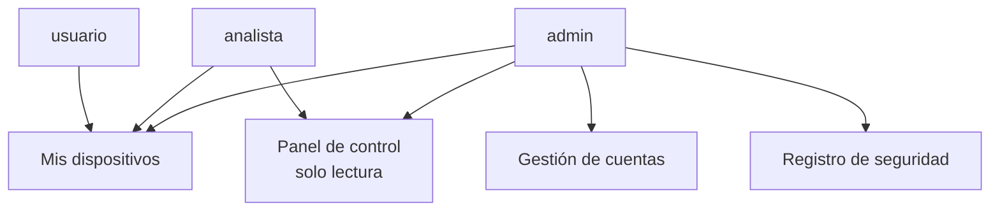

# Seguridad del servidor y privacidad

**Idiomas:** [English](../en/security.md) · [Français](../fr/securite.md) · Español

El servidor (`server/`) es opcional. Sirve para tres cosas: llevar las cuentas, recibir la señal de presencia
de las instalaciones que la han activado y mostrar un panel de control reservado a los roles que tienen permiso.

## Quién ve qué

| Permiso | usuario (`utilisateur`) | analista (`analyste`) | admin (`admin`) |
|---|:---:|:---:|:---:|
| `appareils:les-miens` | sí | sí | sí |
| `tableau:lire` | no | sí | sí |
| `utilisateurs:gerer` | no | no | sí |
| `journal:lire` | no | no | sí |

Cada ruta protegida comprueba la sesión **y después** el permiso: 401 sin sesión, 403 sin el permiso. Los
permisos se definen en un único lugar, `server/src/auth.rs`.

Salvaguardas en la gestión de cuentas: un admin no puede cambiar su propio rol ni desactivar su propia cuenta,
y siempre queda al menos un administrador activo. Desactivar una cuenta cierra todas sus sesiones.

## Qué se almacena

| Dato | Forma |
|---|---|
| Contraseña | huella Argon2id con sal aleatoria — nunca la contraseña |
| Sesión | huella SHA-256 del token — nunca el token; caduca a los 7 días |
| Dispositivo | identificador aleatorio, versión, sistema, contadores, fecha de la última señal |
| Registro | inicios de sesión correctos y rechazados, creaciones de cuenta, cambios de rol |

**Nunca** se almacenan: direcciones IP, nombres o rutas de archivos, huellas de archivos, contenido de correos.
Una señal que contenga un campo desconocido se rechaza (`deny_unknown_fields`).

En el panel de control, el identificador de un dispositivo se trunca a 8 caracteres.

## Defensas en vigor

- **Contraseñas**: 10 caracteres como mínimo, Argon2id. La verificación tarda lo mismo exista o no el alias,
  para no revelar qué cuentas existen.
- **Freno contra intentos masivos**: 8 intentos de inicio de sesión por cuarto de hora para un par
  dirección + alias; 5 creaciones de cuenta por hora y 30 señales por minuto por dirección.
- **Cookie de sesión**: `HttpOnly`, `SameSite=Strict`, y `Secure` cuando `NAANSENTINELS_HTTPS=1`.
- **Anti-CSRF**: toda escritura en la API exige la cabecera `X-NaAnSentinels`, que una página de terceros no
  puede enviar.
- **Cabeceras**: política de contenido estricta (ningún script ni estilo en línea, ningún recurso externo),
  `X-Frame-Options: DENY`, `nosniff`, sin referente, sin caché en la API.
- **Página web**: todo dato procedente del servidor se inserta como texto, nunca como HTML.
- **Peticiones**: cuerpo limitado a 16 KB, entradas validadas (alias, identificador, versión, sistema, contadores).
- **Del lado del antivirus**: HTTPS obligatorio hacia el servidor (HTTP solo se acepta hacia la máquina local);
  la contraseña abandona el campo de entrada en cuanto se envía y nunca se escribe en el disco.

## Límites conocidos — dichos con franqueza

- **La señal es declarativa.** Cualquiera puede enviar señales falsas e inflar los contadores (dentro de lo que
  permite el limitador de tasa). El panel de control es un indicador, no una medición certificada.
- **El limitador de tasa está en memoria**: vuelve a cero al reiniciar y no se comparte entre varias
  instancias.
- **Detrás de un proxy**, el servidor ve la dirección del proxy: el limitador se aplica entonces a todo el mundo
  en conjunto. Hay que adaptarlo (cabecera de confianza) antes de un despliegue público.
- **Sin TLS integrado**: en producción, coloca el servidor detrás de un proxy HTTPS y pon `NAANSENTINELS_HTTPS=1`.
- **El token de sesión del antivirus** se guarda en claro en la carpeta de datos del usuario. Solo da acceso
  a la cuenta de NaAnSentinels, pero no está cifrado.
- **Sin autenticación de dos factores**, sin restablecimiento de contraseña por correo.
- Este servidor no ha sido objeto de una auditoría independiente.

## Desplegar

| Variable | Función | Valor por defecto |
|---|---|---|
| `NAANSENTINELS_ADRESSE` | dirección de escucha | `127.0.0.1:8791` |
| `NAANSENTINELS_BASE` | archivo SQLite | `naansentinels-serveur.db` |
| `NAANSENTINELS_HTTPS` | `1` si el servidor está detrás de HTTPS | `0` |
| `NAANSENTINELS_INSCRIPTIONS` | `ouvertes` (abiertas) o `fermees` (cerradas) | `ouvertes` |

Por defecto el servidor solo escucha en la máquina local. Crea el primer administrador con
`naansentinels-server creer-admin <pseudo>`: la contraseña se pide sin eco y nunca queda en los registros.

## Informar de una vulnerabilidad

Abre una incidencia en el repositorio describiendo el problema sin publicar detalles explotables, o propón
directamente una corrección.
