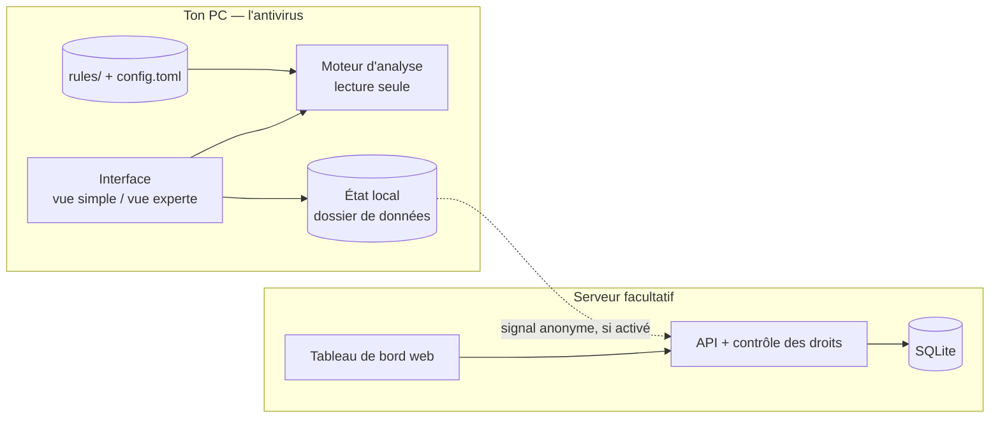
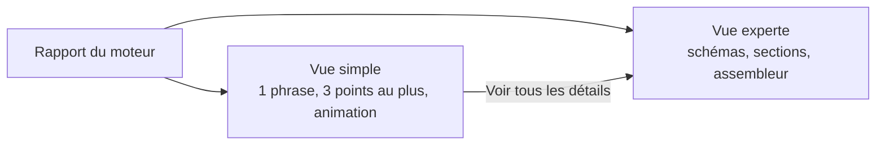

# Architecture de NaAnSentinels

**Langues :** [English](../en/architecture.md) · Français · [Español](../es/arquitectura.md)

Deux programmes dans un même espace de travail Cargo : l'**antivirus** (à la racine) et un **serveur** facultatif
(`server/`). L'antivirus fonctionne entièrement sans le serveur.



## L'antivirus

```
src/
  main.rs            point d'entrée et commandes du terminal
  engine/            LE MOTEUR — aucune interface, aucune action destructrice
    config.rs        config.toml (seuils, thème) ; valeurs par défaut si absent
    rules.rs         rules/signatures.toml (signatures, imports suspects, chaînes)
    verdict.rs       Niveau, Constat, Rapport : le verdict expliqué
    heuristics.rs    entropie, chaînes ASCII, double extension, hex, SHA-256
    pe.rs            analyse statique du format PE : sections, imports, point d'entrée
    disasm.rs        désassemblage x86/x64
    scan.rs          orchestration : un fichier -> un Rapport
  phishing.rs        analyse hors-ligne d'un mail (liens, punycode, urgence…)
  etat.rs            état local : identifiant aléatoire, choix du signal, compteurs
  signal.rs          signal de présence facultatif et compte (HTTPS)
  signature.rs       signature des versions officielles (Ed25519)
  ui/
    mod.rs           fenêtre, barre latérale, anti-phishing, règles, journal, à propos
    theme.rs         habillage : palette, polices, cartes, boutons, dégradés
    bouclier3d.rs    le bouclier en volume : modèle 3D éclairé et animé
    simple.rs        vue simple : bouclier 3D, verdict en une phrase
    expert.rs        vue experte : schémas, carte des sections, désassemblage
    compte.rs        onglet Compte : signal et connexion
config.toml          seuils et thème
rules/signatures.toml  règles de détection
keys/officielle.pub  clé publique des versions officielles
```

### Principes

1. **On n'exécute jamais le fichier analysé.** Tout est statique : lecture, analyse de structure, désassemblage.
2. **Lecture seule.** Le moteur ne bloque, ne déplace ni ne supprime rien. Il produit un rapport.
3. **Expliquer, pas ordonner.** Chaque constat a une *observation* (le fait) et un *pourquoi* (le contexte honnête).
4. **Modifiable.** Les règles et la config sont des fichiers texte ; le moteur est séparé de l'interface.
5. **Rien ne sort sans accord.** Le signal est désactivé par défaut et son contenu est affiché tel quel.

### Le verdict

`Sain` < `À regarder` < `Suspect` < `Dangereux`. Le niveau d'un fichier est celui de son pire constat.

- **Dangereux** : uniquement une **signature exacte** (chaîne, octets ou SHA-256 d'une règle).
- **Suspect / À regarder** : heuristiques (section exécutable et modifiable, forte entropie, fonction importée
  dangereuse, double extension). Jamais une preuve à elles seules.
- **Sain** : rien de connu. Ce n'est **pas** une garantie.

### Les deux vues



La vue simple n'invente rien : son animation rejoue les étapes que le moteur a réellement effectuées, et ses phrases
viennent des mêmes constats que la vue experte.

## Le serveur

```
server/
  src/
    main.rs          lancement, réglages, commande creer-admin
    auth.rs          Argon2id, jetons, rôles et droits
    db.rs            SQLite : comptes, sessions, appareils, journal
    limite.rs        frein de débit en mémoire
    routes.rs        routes HTTP, contrôle des droits, en-têtes de sécurité
  web/               tableau de bord (HTML, CSS, JS embarqués dans l'exécutable)
```

Modèle de sécurité détaillé : [securite.md](securite.md).

## Dépendances principales

| Bibliothèque | Rôle |
|---|---|
| `eframe` / `egui` | interface graphique |
| `goblin` | lecture du format PE |
| `iced-x86` | désassembleur x86/x64 |
| `sha2` | empreintes SHA-256 |
| `serde`, `toml`, `serde_json` | règles, config, état |
| `rfd` | dialogues « ouvrir un fichier » |
| `ureq` | client HTTPS du signal |
| `ed25519-dalek` | signature des versions officielles |
| `axum`, `tokio` | serveur web |
| `rusqlite` | base SQLite |
| `argon2` | empreintes de mots de passe |
