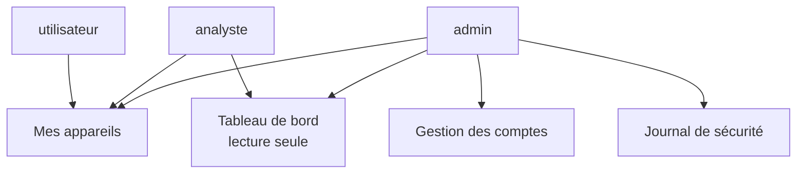

# Sécurité du serveur et vie privée

**Langues :** [English](../en/security.md) · Français · [Español](../es/seguridad.md)

Le serveur (`server/`) est facultatif. Il sert à trois choses : tenir des comptes, recevoir le signal de présence
des installations qui l'ont activé, et afficher un tableau de bord réservé aux rôles qui y ont droit.

## Qui voit quoi

| Droit | utilisateur | analyste | admin |
|---|:---:|:---:|:---:|
| `appareils:les-miens` | oui | oui | oui |
| `tableau:lire` | non | oui | oui |
| `utilisateurs:gerer` | non | non | oui |
| `journal:lire` | non | non | oui |

Chaque route protégée vérifie la session **puis** le droit : 401 sans session, 403 sans le droit. Les droits sont
définis à un seul endroit, `server/src/auth.rs`.

Garde-fous sur la gestion des comptes : un admin ne peut ni changer son propre rôle ni désactiver son propre compte,
et il reste toujours au moins un administrateur actif. Désactiver un compte ferme toutes ses sessions.

## Ce qui est stocké

| Donnée | Forme |
|---|---|
| Mot de passe | empreinte Argon2id avec sel aléatoire — jamais le mot de passe |
| Session | empreinte SHA-256 du jeton — jamais le jeton ; expire au bout de 7 jours |
| Appareil | identifiant aléatoire, version, système, compteurs, date du dernier signal |
| Journal | connexions réussies et refusées, créations de compte, changements de rôle |

Ne sont **jamais** stockés : adresses IP, noms ou chemins de fichiers, empreintes de fichiers, contenu de mails.
Un signal qui contiendrait un champ inconnu est refusé (`deny_unknown_fields`).

Dans le tableau de bord, l'identifiant d'un appareil est tronqué à 8 caractères.

## Défenses en place

- **Mots de passe** : 10 caractères au moins, Argon2id. La vérification prend le même temps que le pseudo existe ou
  non, pour ne pas révéler quels comptes existent.
- **Frein anti-bourrage** : 8 essais de connexion par quart d'heure pour un couple adresse + pseudo ; 5 créations de
  compte par heure et 30 signaux par minute par adresse.
- **Cookie de session** : `HttpOnly`, `SameSite=Strict`, et `Secure` quand `NAANSENTINELS_HTTPS=1`.
- **Anti-CSRF** : toute écriture sur l'API exige l'en-tête `X-NaAnSentinels`, qu'une page tierce ne peut pas envoyer.
- **En-têtes** : politique de contenu stricte (aucun script ni style en ligne, aucune ressource externe),
  `X-Frame-Options: DENY`, `nosniff`, pas de référent, pas de cache sur l'API.
- **Page web** : toute donnée venue du serveur est insérée comme texte, jamais comme HTML.
- **Requêtes** : corps limité à 16 Ko, entrées validées (pseudo, identifiant, version, système, compteurs).
- **Côté antivirus** : HTTPS obligatoire vers le serveur (HTTP accepté seulement vers la machine locale) ; le mot de
  passe quitte le champ de saisie dès l'envoi et n'est jamais écrit sur le disque.

## Limites connues — dites franchement

- **Le signal est déclaratif.** N'importe qui peut envoyer de faux signaux et gonfler les compteurs (dans la limite
  du frein de débit). Le tableau de bord est un indicateur, pas une mesure certifiée.
- **Le frein de débit est en mémoire** : il repart de zéro au redémarrage et ne se partage pas entre plusieurs
  instances.
- **Derrière un proxy**, le serveur voit l'adresse du proxy : le frein s'applique alors à tout le monde ensemble.
  À adapter (en-tête de confiance) avant un déploiement public.
- **Pas de TLS intégré** : en production, place le serveur derrière un proxy HTTPS et mets `NAANSENTINELS_HTTPS=1`.
- **Le jeton de session de l'antivirus** est stocké en clair dans le dossier de données de l'utilisateur. Il ne
  donne accès qu'au compte NaAnSentinels, mais il n'est pas chiffré.
- **Pas de double authentification**, pas de réinitialisation de mot de passe par mail.
- Ce serveur n'a pas fait l'objet d'un audit indépendant.

## Déployer

| Variable | Rôle | Défaut |
|---|---|---|
| `NAANSENTINELS_ADRESSE` | adresse d'écoute | `127.0.0.1:8791` |
| `NAANSENTINELS_BASE` | fichier SQLite | `naansentinels-serveur.db` |
| `NAANSENTINELS_HTTPS` | `1` si le serveur est derrière HTTPS | `0` |
| `NAANSENTINELS_INSCRIPTIONS` | `ouvertes` ou `fermees` | `ouvertes` |

Par défaut le serveur n'écoute que sur la machine locale. Crée le premier administrateur avec
`naansentinels-server creer-admin <pseudo>` : le mot de passe est demandé sans écho et n'est jamais journalisé.

## Signaler une faille

Ouvre un ticket sur le dépôt en décrivant le problème sans publier de détails exploitables, ou propose directement
un correctif.
