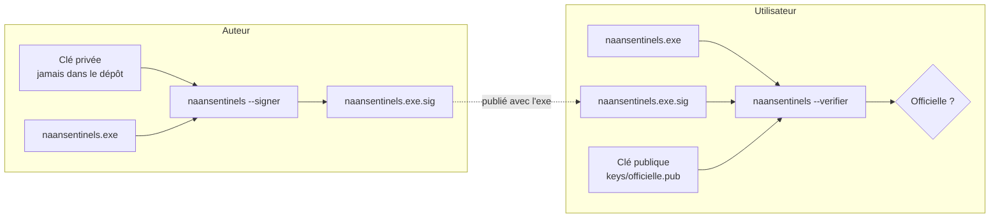

# Signature des versions officielles

**Langues :** [English](../en/signature.md) · Français · [Español](../es/firma.md)

## À quoi ça sert, et à quoi ça ne sert pas

NaAnSentinels est open source : **n'importe qui peut copier, modifier et redistribuer le code**. Aucune technique ne peut
l'empêcher, et ce n'est pas le but.

La signature répond à une autre question : **« cet exécutable vient-il bien de l'auteur d'origine ? »**

- Elle **prouve l'origine** : seul le détenteur de la clé privée peut produire une signature valide pour la clé
  publique `keys/officielle.pub`.
- Elle **détecte toute modification** : un seul octet changé invalide la signature.
- Elle **n'empêche pas la copie**. Une version dérivée peut retirer la vérification ou la remplacer par sa propre clé ;
  mais elle ne pourra jamais présenter l'empreinte officielle.

La protection juridique vient de la **licence** (MIT : la mention de copyright doit être conservée) et du fichier
`NOTICE`. La signature, elle, donne aux utilisateurs un moyen simple de vérifier.



## Vérifier un exécutable

```powershell
naansentinels --verifier naansentinels.exe
```

| Réponse | Sens |
|---|---|
| `OFFICIELLE` | signature valide pour la clé officielle |
| `NON SIGNÉE` | pas de fichier `.sig` : compilation personnelle ou version dérivée |
| `INVALIDE` | fichier modifié, ou signé par une autre clé |

Empreinte de la clé officielle : **`a95e daa9 0120 33aa`**. L'onglet *À propos* affiche le même statut pour
l'exécutable en cours.

## Publier une version officielle (auteur)

```powershell
cargo build --release
target\release\naansentinels.exe --signer target\release\naansentinels.exe
```

Publie ensemble `naansentinels.exe` et `naansentinels.exe.sig`.

La clé privée est dans le dossier de données de l'utilisateur (`%APPDATA%\NaAnSentinels\cle-signature-privee.key`
sous Windows). Elle n'est jamais affichée, jamais écrasée, jamais versionnée. **Fais-en une sauvegarde hors ligne** :
si elle est perdue, il faudra publier une nouvelle clé ; si elle fuit, n'importe qui pourra signer à ta place.

## Signer ta propre version dérivée

```powershell
naansentinels --generer-cle        # crée TA paire de clés ; affiche la clé publique et son empreinte
```

Remplace le contenu de `keys/officielle.pub` par ta clé publique, recompile, signe. Ta version aura alors sa propre
empreinte — différente de l'officielle, ce qui est exactement le but.

## Détails techniques

- Algorithme : Ed25519, vérification **stricte** (les clés faibles et les signatures malléables sont refusées).
- Une clé publique nulle signifie « aucune clé publiée » et ne valide jamais rien.
- La signature porte sur le contenu entier du fichier.
- Limite connue : le statut affiché dans *À propos* est calculé par l'exécutable lui-même. Pour un contrôle
  indépendant, vérifie avec un exécutable de confiance ou un autre outil Ed25519.
